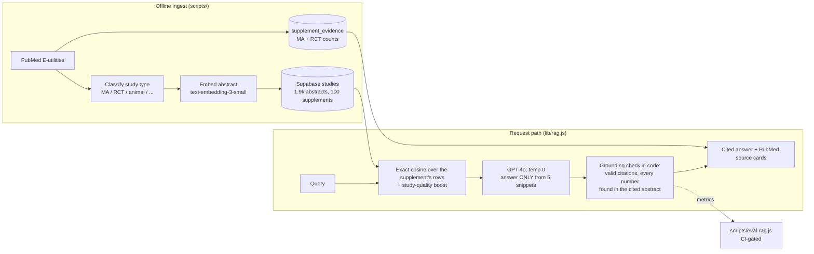

# SupplementScanner

A supplement encyclopedia for Swedish health-conscious consumers, backed by a PubMed retrieval-augmented generation (RAG) pipeline. Every study claim a user sees is generated only from PubMed abstracts we have stored, cited back to the PMID, and checked in code before it is shown.

- **Web:** https://www.supplementscanner.io (Vite/React on Vercel)
- **API:** https://supplementscanner-production.up.railway.app (Express on Railway)
- **Mobile:** Expo/React Native companion app (encyclopedia, stack, saved deep-dives)

## 🧠 AI architecture



**Two products on one pipeline**

| | Free supplement page | Premium deep-dive |
|---|---|---|
| Endpoint | `GET /api/encyclopedia/deep-dive/:slug` | `POST /api/premium/deep-dive/:slug` |
| Output | Cited summary + 3–4 findings + real study stats | Full report, ask-a-question, limitations ("the catch"), studied vs retail dose |
| Cache | Shared, 30-day TTL, versioned | Per user, versioned |
| Guardrail | Drops the summary/finding if any number is ungrounded | Drops only the failing sentence or item, reports what it dropped |

**Hallucination guardrails, in layers**
1. **Retrieval-only context.** The prompt contains the top 5 abstracts for that supplement and nothing else; temperature 0; the model must say "The available studies don't address this" when the snippets can't answer.
2. **Code-level grounding check** (`lib/rag.js`). Every `[N]` citation must point at a retrieved snippet, and every number in a sentence must appear in the abstract it cites. Sentences that fail are removed before the response leaves the server.
3. **Insufficient-evidence short circuit.** With fewer than 3 stored studies the LLM is never called.
4. **No model-estimated numbers.** Study counts and the "research base" score come from PubMed counts (meta-analyses + RCTs), not from the model.
5. **Labelled general guidance.** The stack schedule/overlap suggestions (Claude Haiku 4.5) are not retrieval-grounded, so the API marks them `insights_basis: "general_guidance"` and the UI labels them as such.

**Design decisions worth knowing**
- **Exact search instead of the ivfflat index.** pgvector's ivfflat index scanned one list and *then* applied the per-supplement filter, silently returning 0–2 rows for most supplements. With ~20 abstracts per supplement, exact cosine in code is both correct and fast; an index only makes sense again at much larger per-supplement counts (HNSW with filtered search, or per-supplement partitions).
- **Study-quality boost.** Similarities between one supplement's abstracts sit within a few hundredths, so pure similarity favoured narrative reviews over the meta-analyses they summarise; a small boost (+0.06 MA, +0.04 RCT, −0.06 animal) fixes the ranking.
- **"Research base" instead of "confidence".** The old score averaged the study types of the 5 retrieved abstracts (caffeine scored 30%). It now log-scales PubMed MA + RCT counts, and the UI says it measures research volume, not efficacy.

## 📏 Evaluation

`npm run eval:rag` runs three suites against the live corpus, writes a JSON report to `scripts/eval/reports/`, and exits non-zero if a gated metric drops below its threshold. It runs in CI (`.github/workflows/rag-eval.yml`) on PRs that touch retrieval, grounding or ingest code.

| Suite | What it measures | Latest run (2026-11-25) |
|---|---|---|
| Coverage | Supplements with ≥3 stored studies | 95% (gaps: 5-HTP 0, kava, passionflower, forskolin, niacin) |
| Retrieval | Known-item search: query by a stored study's title, recall@1 / @5, MRR | 97.5% / 100% / 0.98 |
| Generation | 14 cases ([`scripts/eval/rag-cases.json`](scripts/eval/rag-cases.json)): grounded-item rate, citation coverage, answer rate, refusal accuracy, prompt-injection resistance, latency | 97.5% grounded, 90% answered, 100% refusals, 100% injection resisted, p50 2.5s |

The eval already surfaced a real corpus gap: none of the stored vitamin D3 abstracts cover respiratory infections, so that question is (correctly) refused. The fix is a targeted ingest, not a relaxed test. `npm run eval:rag:retrieval` skips the GPT-4o suite (embeddings only).

## 🚀 Tech stack

- **Backend:** Node.js / Express 5, Supabase (Postgres + pgvector + Auth), Stripe, Zod, express-rate-limit
- **AI:** OpenAI `text-embedding-3-small` (retrieval), GPT-4o (grounded generation, product extraction), Claude Haiku 4.5 (stack insights, tool-use structured output), Claude via Jina for retailer page extraction
- **Web:** React 18 + TypeScript, Vite, React Router v7, Tailwind v4, i18next (en/sv), build-time prerendering for SEO
- **Mobile:** Expo SDK 54 / React Native 0.81, Expo Router, Supabase Auth (email + Google OAuth)
- **Infra:** Vercel (web), Railway (API), GitHub Actions (lint, deploy, RAG eval)

## 📁 Project structure

```
SuppScanner/
├── server.js                  # Express API: routes, auth, payments, product ingest
├── lib/rag.js                 # RAG core: retrieval, grounding checks, free + premium generators
├── src/                       # Web frontend (pages, components, i18n, encyclopediaData.ts = 100 supplements)
├── api/                       # Product ingest/lookup route handlers
├── scripts/
│   ├── ingest-pubmed.js       # PubMed fetch → classify → embed → upsert; MA/RCT counts
│   ├── evidence-terms.js      # PubMed search terms per supplement
│   ├── seed-interactions.js   # Hand-curated, source-cited interaction rows
│   ├── eval-rag.js            # RAG evaluation harness (CI-gated)
│   ├── eval/rag-cases.json    # Generation eval cases
│   └── supabase-schema.sql    # Database schema
├── .claude/skills/            # Claude Code skill for adding supplements end to end
└── SuppScannerApp/            # Expo mobile app
```

## 🛠️ Development

```bash
cd SuppScanner/
npm install
npm run start:full          # Vite + Express
npm run ingest:pubmed       # (re)ingest PubMed abstracts; --slug <slug> for one supplement
npm run eval:rag            # full RAG eval (~$0.15 of GPT-4o)
npm run eval:rag:retrieval  # coverage + retrieval only
npm run lint
```

Mobile: `cd SuppScannerApp && npm install && npm start`.

Copy `.env.example` to `.env.local` and set `OPENAI_API_KEY`, `ANTHROPIC_API_KEY`, `SUPABASE_URL`, `SUPABASE_ANON_KEY`, `SUPABASE_SERVICE_ROLE_KEY` (plus the Stripe keys for payments). The RAG eval workflow needs `OPENAI_API_KEY`, `SUPABASE_URL` and `SUPABASE_SERVICE_ROLE_KEY` as GitHub secrets.

## 📚 Documentation

- `CLAUDE.md` — development guide (read first)
- `ROADMAP.md` — what's done, next, and deferred
- `DEEP_DIVE_PREMIUM_PLAN.md` — original premium RAG design
- `docs/` — context, agent workflow, decisions
